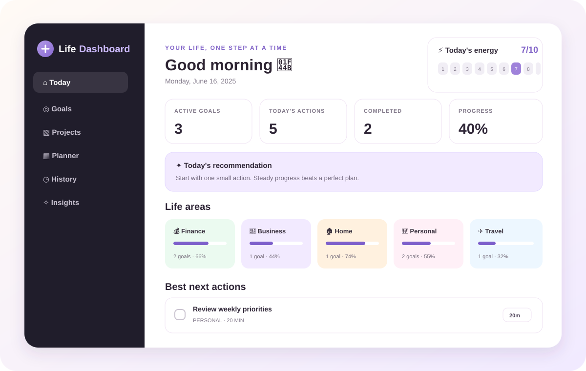

  
  <h1>Life Dashboard</h1>
  
<strong>A private personal dashboard for goals, tasks, and everyday progress.</strong>

  
Local-first · Private by default · No backend required

  

Life Dashboard is a private, browser-based personal dashboard for tracking goals, projects, tasks, energy, and progress in one place. It is designed to stay simple, local-first, and useful without a backend or account.

## What it does

- Track goals by life area
- Manage projects and tasks
- Review daily actions and priorities
- Monitor energy and focus
- Keep a simple activity history
- Export and restore a local backup

## Run locally

1. Clone this repository.
2. Open `index.html` in a modern browser.
3. Start using it immediately.

No build step or dependencies are required.

## Privacy and data

This project is meant to be a simple local-first tool for personal use.

- Data is stored in the browser's local storage
- There is no account system
- There is no backend or cloud sync
- Backups can be exported manually as JSON

This is intended to keep the app easy to run and easy to keep private.

## Screenshots and assets

The preview image is an illustrative SVG mockup rather than a captured screenshot of a running browser. Branding and supporting assets live in [`assets/`](assets/).

## Contributing

This project is primarily a personal tool, but ideas and feedback are welcome. If you want to propose a larger change, please open an issue first.

## License

MIT. See [`LICENSE`](LICENSE).
